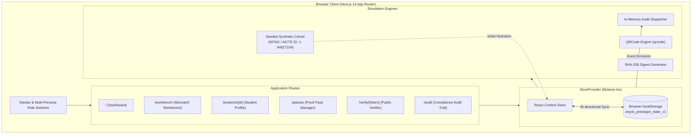

# Zeycb — APAAR-ID Student Data Management & Verification Platform

> **Smart India Hackathon (SIH) Prototype** | **Problem Statement ID: SIH26263**  
> *Records That Prove Themselves: Institutional student-record readiness, provenance reconciliation, and privacy-preserving credential verification for AICTE-approved institutions.*

---

## Table of Contents

- [Regulatory & Prototype Disclaimers](#️-regulatory--prototype-disclaimers)
- [Problem Statement & Background](#-problem-statement--background)
- [Solution Overview](#-solution-overview)
- [Key Features](#-key-features)
- [System Architecture](#-system-architecture)
- [Multi-Persona Access Matrix](#-multi-persona-access-matrix)
- [Differentiators: Zeycb vs. Conventional SIS](#-differentiators-zeycb-vs-conventional-sis)
- [Technology Stack](#-technology-stack)
- [End-to-End Evaluation Workflow](#-end-to-end-evaluation-workflow)
- [Repository Structure](#-repository-structure)
- [Getting Started & Local Setup](#-getting-started--local-setup)
- [Data Storage & Seeded State Management](#-data-storage--seeded-state-management)
- [Testing & Validation](#-testing--validation)
- [Security, Privacy & Data Handling](#-security-privacy--data-handling)
- [Limitations & Future Roadmap](#-limitations--future-roadmap)
- [SIH Problem Statement Reference](#-sih-problem-statement-reference)
- [Acknowledgements](#-acknowledgements)

---

## ⚠️ Regulatory & Prototype Disclaimers

Before evaluating this platform, please note the following operational boundaries:

1. **Competition Prototype Only**: Zeycb is an academic research prototype developed specifically for Smart India Hackathon problem statement **SIH26263**. It is **not** an official platform of APAAR, DigiLocker, the Academic Bank of Credits (ABC), UIDAI (Aadhaar), or the All India Council for Technical Education (AICTE).
2. **Synthetic Data Exclusively**: All student identities, roll numbers, APAAR IDs, and academic records are 100% fictional and synthetic. Real student information and live national identifiers are never ingested, requested, or stored.
3. **Simulated Institutional Feeds**: Ingestion feeds (Institute SIS, simulated ABC Portal, DigiLocker mock endpoints, and CBSE examination ledgers) are simulated in-process. No live government APIs are called.
4. **Simulated Proof Digests**: Proof Pass tokens feature client-side SHA-256 demonstration digests. They illustrate selective disclosure principles and are not asymmetric PKI digital signatures or government-issued credentials.
5. **Human-in-the-Loop Mandatory**: AI advisory modules analyze and summarize discrepancy provenance, but **cannot silently alter records or decide outcomes**. An authorized institutional officer must review evidence and sign off on all reconciliation actions.
6. **Data Minimization by Default**: All national identifiers are masked by default (`AP-••••-••••-8921`). Unmasking requires statutory justification and produces a tamper-evident audit trail event.

---

## 📌 Problem Statement & Background

### Context (SIH26263)
The Ministry of Education and AICTE mandate the adoption of the **Automated Permanent Academic Account Registry (APAAR / One Nation, One Student ID)** across accredited higher-education institutions in India. While APAAR establishes a persistent identifier linked to the Academic Bank of Credits (ABC), AICTE-approved institutions face critical operational hurdles:

1. **Multi-Source Data Fragmentation**: Student demographic and academic information is siloed across local Admissions ERPs, state examination boards, ABC depository feeds, and scholarship portals.
2. **Discrepancy Bottlenecks**: Minor variances (middle name omissions, transliteration differences, or date-of-birth offsets) stall student credential issuance, credit transfers, and degree conferrals.
3. **Over-Disclosure & Privacy Risks**: Traditional verification processes require sharing unredacted academic transcripts that expose sensitive personal information—including home addresses, parent details, date of birth, and full national IDs—to external employers and background-check agencies.
4. **Lack of Instant Revocability**: Once a physical transcript or static PDF certificate is released, institutions have no mechanism to invalidate or expire access if errors or administrative holds emerge.

---

## 💡 Solution Overview

**Zeycb** (*Records That Prove Themselves*) is an institutional data management and credential verification platform designed for registrars, academic heads, and compliance officers in AICTE institutions.

```
+-----------------------------------------------------------------------------------+
|                                  ZEYCB PLATFORM                                   |
|                                                                                   |
|  [ Ingest Feeds ] ----> [ Provenance Workbench ] ----> [ Selective Disclosure ]  |
|   • Local SIS             • Side-by-side diff           • Privacy-first tokens    |
|   • ABC Depository        • AI Advisory explanation     • Configurable expiry     |
|   • DigiLocker Mock       • Physical vault ledger       • Instant revocation      |
|   • State Boards          • Human-in-the-loop signoff   • Zero sensitive PII      |
+-----------------------------------------------------------------------------------+
```

Zeycb addresses the problem through four architectural pillars:
- **Readiness Indexing**: Real-time evaluation of student record integrity, tracking field-level provenance across internal and external feeds.
- **Human-in-the-Loop Mismatch Workbench**: AI provenance summaries explain discrepancies without auto-merging; institutional staff cross-examine physical ledger references to authorize authoritative values.
- **Proof Pass Credential Engine**: Generates time-limited, revocable verification links and QR codes exposing only authorized academic attributes while explicitly itemizing withheld personal data.
- **Tamper-Evident Chronological Audit Log**: Immutable record of every view, compliance unmask attempt, staff reconciliation, and external verifier access event.

---

## 🚀 Key Features

### 1. Institutional Readiness Dashboard (`/`)
- **Readiness Scoring**: Aggregate and student-level percentage metrics indicating alignment between local institutional records and depository feeds.
- **Triage Cards**: Clear counters for pending discrepancies, active Proof Passes, and fully verified candidates ready for degree conferral.
- **Urgent Mismatch Callout**: Immediate visual escalation for records with high-severity source discrepancies (e.g., Priya Sharma's birth year conflict).
- **Monitored Cohort Roster**: Filterable directory (All, Flagged, Ready, Proof Active) with masked APAAR identifiers, departmental tags, and direct inspection links.

### 2. Provenance Mismatch Workbench (`/workbench`)
- **Side-by-Side Field Comparison**: Direct visual diff between Source A (*Institute Admissions SIS*) and Source B (*ABC Depository Feed*).
- **AI Decision Support (Advisory Only)**: Heuristic provenance analysis explaining probable root causes (e.g., pre-enrolment draft index vs. matriculation certificate) with non-binding recommendations.
- **Physical Evidence Corroboration**: Traceability to physical admission ledgers and matriculation records stored in institutional vaults (e.g., *CBSE Matriculation Certificate #82190*).
- **Attributed Staff Sign-off**: Mandatory justification note and officer attribution (*Deputy Registrar* or *Department Head*) before records transition to verified status.

### 3. Student Profile & Provenance Matrix (`/students/[id]`)
- **Field-Level Source Attribution**: Every academic attribute (Name, DOB, Program, Semester, CGPA, Credits) displays source origin, sync timestamp, and confidence rating.
- **Compliance Identifier Masking**: APAAR IDs and national references masked by default. An interactive modal enforces formal justification before unmasking.
- **Chronological Change Log**: Complete audit history tracking the lifecycle of the student record from initial JoSAA enrolment to credit audits.

### 4. Selective Disclosure Proof Pass (`/passes` & `/verify/[token]`)
- **Configurable Privacy Policy**: Staff selectively toggles academic attributes (Degree, Program, Term, CGPA, Earned Credits) while keeping demographic data strictly withheld.
- **Time-Limited Validity Windows**: Tokens can be set to expire in 1 hour, 24 hours, 7 days, or 30 days.
- **Instant Revocation**: Real-time invalidation button instantly shifts credentials into a revoked state, rendering public verification links and QR codes invalid.
- **External Verifier Portal**: Clean, standalone portal for employers and evaluators showing verified attributes, explicit list of withheld fields, and client-side SHA-256 demo digest.

### 5. Institutional Audit Trail (`/audit`)
- **Chronological Activity Log**: Captures record views, compliance unmasks, discrepancy resolutions, token generations, and third-party verification events.
- **Action & Status Filtering**: Real-time filtering by action type (`RECORD_VIEW`, `UNMASK_ATTEMPT`, `DISCREPANCY_RESOLVE`, `PROOF_PASS_CREATED`, `PROOF_PASS_REVOKED`) and compliance status.
- **JSON Export**: One-click export of the complete audit log for external regulatory inspection.

---

## 🏗️ System Architecture

Zeycb is built as a single-tier, zero-external-dependency web application leveraging Next.js 14 App Router and React Context architecture.



---

## 👥 Multi-Persona Access Matrix

Zeycb features an interactive role switcher that dynamically alters application behavior, scoping, and permissions without page reloading:

| Feature / Route | Registrar Office (`#RO-402`) | Department Academic Head (CSE) | Auditor / Compliance Inspector | External Verifier |
| :--- | :---: | :---: | :---: | :---: |
| **Institutional Overview (`/`)** | Full Cohort (All Departments) | Scoped to CSE Cohort Only | Read-Only Full Cohort | Redirected to Verifier Portal |
| **Mismatch Workbench (`/workbench`)** | Full Resolution & Proof Trigger | Departmental Sign-off (Prof. Verma) | Read-Only Inspection Mode | Access Blocked |
| **Student Detail (`/students/[id]`)** | Full Access & Proof Pass Modal | Scoped to Department Students | Read-Only Record Inspection | Access Blocked |
| **Proof Pass Manager (`/passes`)** | Issue & Revoke Authority | Read-Only (Issuance Restricted) | Read-Only (Issuance Restricted) | Access Blocked |
| **External Verifier (`/verify/[id]`)** | Full Inspection & Demo Revoke | Full Inspection & Demo Revoke | Full Inspection & Demo Revoke | Public View (No Staff Actions) |
| **Audit Trail (`/audit`)** | Full View & JSON Export | Full View & JSON Export | Full View & JSON Export | Access Blocked |

---

## ⚖️ Differentiators: Zeycb vs. Conventional SIS

| Dimension | Conventional Student Information Systems | Zeycb (SIH26263 Prototype) |
| :--- | :--- | :--- |
| **Identifier Handling** | Exposes raw Aadhaar / APAAR numbers across student records. | **Masked by default** (`AP-••••-••••-8921`); unmasking requires statutory justification. |
| **Data Ingestion** | Blind automated overwrites during batch synchronization. | **Field-level provenance** showing source, timestamp, and confidence score. |
| **Discrepancy Handling** | Unflagged silent errors or hard administrative blocks. | **Human-in-the-loop Workbench** with AI explanation and physical ledger audit. |
| **Credential Sharing** | Issues static, unredacted PDFs containing sensitive personal PII. | **Selective Disclosure Proof Pass** with explicit list of withheld fields. |
| **Access Control** | Static credentials valid indefinitely once downloaded. | **Time-limited validity windows** (1h to 30d) with **single-click instant revocation**. |
| **Audit Compliance** | Fragmented server access logs rarely accessible to registrars. | **Exportable, chronological compliance trail** recording all actions and views. |

---

## 💻 Technology Stack

### Core Framework & Runtime
- **Next.js 14.2.15**: App Router architecture with client-side reactive components.
- **React 18.3.1**: Component model, React Context API, and state hooks.
- **TypeScript 5.6.3**: Strict typing for provenance objects, student fields, and audit entries.

### Styling & Design System
- **Tailwind CSS 3.4.14**: Utility-first CSS tailored with an editorial higher-education palette:
  - `canvas`: `#FAF9F5` (Warm editorial white canvas)
  - `ink`: `#0F172A` / `#1E293B` (Deep slate typography)
  - `cobalt`: `#1E40AF` / `#2563EB` (Restrained primary institutional accent)
  - `urgent`: `#B45309` / `#D97706` (Amber reserved strictly for unresolved conflicts)
- **Typography Tokens**: System font stacks utilizing `Plus Jakarta Sans`, `Newsreader` (serif headings), and `JetBrains Mono` (identifiers and digests).
- **Lucide React 0.453.0**: Clean, consistent functional iconography.

### Cryptography & Utility Packages
- **qrcode 1.5.4**: In-browser vector DataURL generation for Proof Pass verification links.
- **clsx 2.1.1** & **tailwind-merge 2.5.4**: Predictable conditional CSS class composition.

---

## 🔄 End-to-End Evaluation Workflow

Follow this **two-minute walkthrough** during judge evaluation to observe the complete lifecycle:

```
[ Step 1: Dashboard ]       Observe Priya Sharma's flagged conflict (88% initial readiness).
         │
         ▼
[ Step 2: Workbench ]       Compare Admission SIS vs. ABC feed. Inspect AI Advisory & physical vault reference.
         │
         ▼
[ Step 3: Staff Seal ]      Click "Approve Resolution & Seal Record". Readiness jumps to 98%.
         │
         ▼
[ Step 4: Issue Pass ]      Select Degree & CGPA; withhold DOB & Address. Issue a 24-hour Proof Pass.
         │
         ▼
[ Step 5: Verification ]    Open /verify/[token]. Observe AUTHENTICATED status and withheld fields list.
         │
         ▼
[ Step 6: Revocation ]      Click "Simulate Instant Revocation". Witness live change to REVOKED banner.
         │
         ▼
[ Step 7: Audit Log ]       Visit /audit. Review complete chronological log with actor attribution.
```

---

## 📂 Repository Structure

```
d:/PROJECTS/ZEYCB/
├── app/                              # Next.js 14 App Router Directory
│   ├── audit/                        # Institutional Audit Log & Access Trail
│   │   └── page.tsx
│   ├── passes/                       # Proof Pass Token Management
│   │   └── page.tsx
│   ├── students/                     # Student Record Details & Provenance
│   │   └── [id]/
│   │       └── page.tsx
│   ├── verify/                       # Public External Verifier Portal
│   │   └── [id]/
│   │       └── page.tsx
│   ├── workbench/                    # Source Mismatch & Reconciliation Workbench
│   │   └── page.tsx
│   ├── globals.css                   # Global styles & design tokens
│   ├── layout.tsx                    # Root layout wrapping StoreProvider & Navbar
│   └── page.tsx                      # Primary Institutional Overview Dashboard
├── components/                       # Reusable Presentation & Modal Components
│   ├── Navbar.tsx                    # Header with persistent role switcher & navigation
│   ├── ProofPassModal.tsx            # Selective disclosure issuance dialog
│   ├── SimulatedBadge.tsx            # Quiet institutional prototype disclaimer bar
│   └── UnmaskModal.tsx               # Compliance justification dialog for masked IDs
├── lib/                              # Core Domain Logic, State, and Fixtures
│   ├── mock-data.ts                  # Fictional synthetic cohort (NITAS / AICTE 1-94827104)
│   ├── store.tsx                     # React Context Provider with localStorage persistence
│   ├── types.ts                      # Domain TypeScript interfaces (StudentField, ProofPass, etc.)
│   └── utils.ts                      # Date formatting, expiry calculations & QR generation
├── package.json                      # Project dependencies and script definitions
├── tailwind.config.js                # Editorial higher-ed theme configuration
├── tsconfig.json                     # TypeScript compiler configuration
└── README.md                         # Project documentation
```

---

## ⚙️ Getting Started & Local Setup

### Prerequisites
- **Node.js**: Version `18.17.0` or higher (Node 20 LTS recommended).
- **Package Manager**: `npm` (version 9+ or 10+).

### Installation

1. **Clone the repository**:
   ```bash
   git clone https://github.com/your-username/zeycb-prototype.git
   cd zeycb-prototype
   ```

2. **Install project dependencies**:
   ```bash
   npm install
   ```

3. **Start the local development server**:
   ```bash
   npm run dev
   ```

4. **Access the application**:
   Open [http://localhost:3000](http://localhost:3000) (or [http://localhost:3001](http://localhost:3001) if port 3000 is occupied) in any modern Chromium, Firefox, or Safari browser.

### Environment Variables
The prototype is self-contained and intentionally operates without external cloud dependencies or API keys. To configure custom port bindings, you may optionally create a `.env.local` file:

```env
# Optional port configuration (Defaults to 3000)
PORT=3000
```

---

## 🗄️ Data Storage & Seeded State Management

Zeycb utilizes an in-browser persistent store designed for deterministic demo evaluation:

- **Storage Key**: `zeycb_prototype_state_v1` in browser `localStorage`.
- **Seeded Cohort**: Initialized with four diverse student profiles from the fictional *National Institute of Technology & Advanced Sciences (NITAS)*:
  1. `stu-001` (**Priya Sharma**, B.Tech CSE): Seeded discrepancy between Admissions ERP (`2004-08-15`) and ABC portal (`2003-08-15`).
  2. `stu-002` (**Rohan Verma**, B.Tech ME): Reconciled record eligible for convocation degree conferral.
  3. `stu-003` (**Ananya Iyer**, M.Tech AI): Postgraduate candidate with pending MOOC / NPTEL transfer credits.
  4. `stu-004` (**Vikramaditya Rao**, B.Tech ECE): Active Proof Pass token recipient.
- **One-Click Demo Reset**: To restore all records, tokens, and audit events to their initial state, open the role menu in the navbar and click **"Reset Seeded Demo Data"**.

---

## 🧪 Testing & Validation

### Codebase Verification
Execute standard Next.js verification commands:

```bash
# 1. Type-check TypeScript sources
npx tsc --noEmit

# 2. Run Next.js linter
npm run lint

# 3. Create production build bundle
npm run build

# 4. Start production server
npm start
```

### Manual Validation Checklist
- [x] **Dashboard Scoping**: Switching to *Department Academic Head* filters the cohort exclusively to Computer Science & Engineering.
- [x] **Auditor Lockdown**: Switching to *Auditor* navigates to `/audit` and disables mutating actions in the Workbench.
- [x] **External Verifier Route Guard**: Attempting direct navigation to `/workbench` while in *External Verifier* mode redirects back to `/verify/[token]`.
- [x] **Proof Invalidation**: Revoking a Proof Pass immediately renders the verifier portal invalid on subsequent views.

---

## 🔒 Security, Privacy & Data Handling

1. **Zero Real PII Guarantee**: Zeycb does not connect to live Aadhaar, DigiLocker, or AICTE production servers. Synthetic data prevents accidental exposure of real student records.
2. **Selective Disclosure by Design**: Evaluators and employers only receive the specific fields an institution authorizes. Date of birth, home address, parentage, and financial aid status remain withheld.
3. **Statutory Justification Auditing**: Viewing masked identifiers requires entering a compliance justification, permanently recording the officer's name, role, timestamp, and IP.
4. **Client-Side Cryptographic Digest**: Each Proof Pass generates a client-side SHA-256 digest over the disclosed attributes, demonstrating token sealing principles.

---

## 🔮 Limitations & Future Roadmap

| Current Prototype Implementation | Production Target Architecture |
| :--- | :--- |
| In-browser `localStorage` state management. | Enterprise PostgreSQL database with Prisma ORM and row-level security (RLS). |
| Synthetic JSON feed ingestors. | Official API integrations via DigiLocker NAD API and Academic Bank of Credits (ABC) Gateway. |
| Client-side SHA-256 demo digest. | W3C Verifiable Credentials (VC) with Ed25519 digital signatures and institution PKI certificates. |
| Simulated persona switcher. | OpenID Connect / Jan Parichay (National Single Sign-On) integration with institutional SAML/SSO. |
| Client-side audit log export. | Immutable append-only audit ledger (Hyperledger Fabric or signed cloud compliance storage). |

---

## 🏆 SIH Problem Statement Reference

- **Competition**: Smart India Hackathon (SIH)
- **Problem Statement ID**: **SIH26263**
- **Title**: *Development of an APAAR ID-Based Student Data Management and Verification Platform for AICTE-Approved Institutions*
- **Theme**: Smart Education / Governance & Administrative Automation
- **Target Beneficiaries**: AICTE-Approved Higher Education Institutions, University Registrars, Verification Agencies, and Students.

---

## 🤝 Acknowledgements

- **All India Council for Technical Education (AICTE)** & **Ministry of Education (MoE)** for defining the APAAR integration guidelines.
- **Smart India Hackathon** for providing the problem statement framework.
- Built with [Next.js](https://nextjs.org), [Tailwind CSS](https://tailwindcss.com), and [Lucide Icons](https://lucide.dev).
