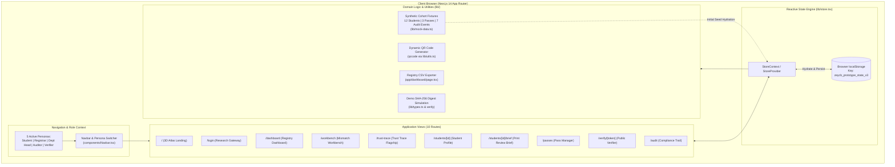

# Zeycb — AICTE Student Credential Provenance & Proof Pass Registry

> **Smart India Hackathon (SIH) Prototype** | **Problem Statement ID: SIH26263**  
> *Records That Prove Themselves: Institutional student-record readiness, multi-source provenance reconciliation, and privacy-preserving Proof Pass verification for AICTE-approved institutions.*

---

## Table of Contents

- [Regulatory & Prototype Disclaimers](#-regulatory--prototype-disclaimers)
- [Problem Definition & Background](#-problem-definition--background)
- [Proposed Solution & Core Pillars](#-proposed-solution--core-pillars)
- [Application Routes & Page Directory](#-application-routes--page-directory)
- [System Architecture & Data Flow](#-system-architecture--data-flow)
- [Comprehensive Feature Overview](#-comprehensive-feature-overview)
  - [1. Dimensional Atlas & Public Overview (`/`)](#1-dimensional-atlas--public-overview-)
  - [2. Research Demo Sign-In & Role Gateway (`/login`)](#2-research-demo-sign-in--role-gateway-login)
  - [3. Institutional Registry Dashboard (`/dashboard`)](#3-institutional-registry-dashboard-dashboard)
  - [4. Provenance Mismatch Workbench (`/workbench`)](#4-provenance-mismatch-workbench-workbench)
  - [5. Trust Trace Provenance Suite (`/trust-trace`)](#5-trust-trace-provenance-suite-trust-trace)
  - [6. Candidate Profile & Identifier Unmasking (`/students/[id]`)](#6-candidate-profile--identifier-unmasking-studentsid)
  - [7. Print-Friendly Student Review Brief (`/students/[id]/brief`)](#7-print-friendly-student-review-brief-studentsidbrief)
  - [8. Proof Pass Lifecycle Manager (`/passes`)](#8-proof-pass-lifecycle-manager-passes)
  - [9. External Verifier Portal (`/verify/[id]`)](#9-external-verifier-portal-verifyid)
  - [10. Institutional Compliance Audit Trail (`/audit`)](#10-institutional-compliance-audit-trail-audit)
- [Multi-Persona Access Matrix](#-multi-persona-access-matrix)
- [Synthetic Cohort & Seeded Scenarios](#-synthetic-cohort--seeded-scenarios)
- [Technology Stack & Dependencies](#-technology-stack--dependencies)
- [Repository Directory Structure](#-repository-directory-structure)
- [Getting Started & Local Setup (Windows)](#-getting-started--local-setup-windows)
- [State Management & Data Persistence](#-state-management--data-persistence)
- [Testing & Quality Assurance](#-testing--quality-assurance)
- [Security, Privacy & Data Governance](#-security-privacy--data-governance)
- [Limitations & Future Roadmap](#-limitations--future-roadmap)
- [SIH Problem Statement Reference](#-sih-problem-statement-reference)
- [License & Repository Status](#-license--repository-status)
- [Acknowledgements](#-acknowledgements)

---

## ⚠️ Regulatory & Prototype Disclaimers

Before evaluating or deploying this platform, please note the following operational boundaries:

1. **Competition Research Prototype Only**: Zeycb is an academic research prototype engineered specifically for Smart India Hackathon problem statement **SIH26263**. It is **not** an official platform of APAAR, DigiLocker, the Academic Bank of Credits (ABC), UIDAI (Aadhaar), or the All India Council for Technical Education (AICTE).
2. **Strictly Synthetic Demonstration Dataset**: All student names, registration numbers, APAAR IDs, Aadhaar references, addresses, and marks are entirely fictional. Real student records and live government credentials are never collected, requested, or stored.
3. **Simulated Ingestion Feeds**: Upstream intake sources (Admissions ERP, simulated ABC Depository feed, DigiLocker mock endpoints, and state examination board ledgers) operate via client-side fixtures. No external government servers or live production APIs are queried.
4. **Demonstration Digests, Not Legal Digital Signatures**: Proof Passes feature client-side demonstration digests (e.g., SHA-256 string prototypes) to illustrate verification integrity and selective disclosure concepts. They do not constitute asymmetric PKI digital signatures, e-Signatures under the Information Technology Act, or officially gazetted credentials.
5. **Mandatory Human-in-the-Loop Governance**: AI advisory explanations and discrepancy warnings are advisory only. Automated algorithms cannot silently overwrite student records. An authorized institutional officer (Registrar) must physically review supporting evidence and sign off on all reconciliation decisions.
6. **Privacy Minimization by Default**: All sensitive identifiers are masked by default (`AP-SYN-••••-0001`). Unmasking requires mandatory statutory justification and emits a permanent, immutable event to the compliance audit log.

---

## 📌 Problem Definition & Background

### Operational Context (SIH26263)
Under the National Education Policy (NEP) and AICTE mandates, Indian higher-education institutions are adopting the **Automated Permanent Academic Account Registry (APAAR / One Nation, One Student ID)**, linked directly with the **Academic Bank of Credits (ABC)**. In practice, registrars, examination heads, and academic evaluators encounter four critical operational bottlenecks:

```
┌──────────────────────────────────────────────────────────────────────────────────┐
│                            THE INSTITUTIONAL DILEMMA                             │
├────────────────────────────────┬─────────────────────────────────────────────────┤
│ 1. Multi-Source Ingestion Diff │ Admissions ERP, ABC Depository, DigiLocker, and │
│                                │ State Boards disagree on names, DOBs, and terms │
├────────────────────────────────┼─────────────────────────────────────────────────┤
│ 2. Opaque Discrepancy Audits   │ Discrepancy handling is manual and untracked;   │
│                                │ no verifiable chain of custody for corrections  │
├────────────────────────────────┼─────────────────────────────────────────────────┤
│ 3. Over-Disclosure Privacy Risk│ Conventional transcripts leak raw DOBs, Aadhaar,│
│                                │ home addresses, and parentage to 3rd parties    │
├────────────────────────────────┼─────────────────────────────────────────────────┤
│ 4. Static Credential Rigidity  │ Issued paper degrees and static PDFs cannot be  │
│                                │ scoped, expired after 24 hours, or revoked      │
└────────────────────────────────┴─────────────────────────────────────────────────┘
```

1. **Multi-Source Ingestion Variances**: Candidate data collected during JoSAA admission frequently diverges from DigiLocker feeds or pre-enrolment ABC records (e.g., patronymic name expansions like *"Aarav N."* vs. *"Aarav Narayan"*, or birth year typographical offsets).
2. **Administrative Stalls**: Minor discrepancies block credit recognition and degree conferral. Without a dedicated provenance ledger, staff cannot trace which source introduced a variance.
3. **Over-Disclosure & Identity Exposure**: Sharing full transcripts with employers, recruiters, or evaluation agencies exposes permanent citizen identifiers (Aadhaar, APAAR), birth dates, home addresses, and parental details, violating data minimization standards.
4. **Absence of Instant Revocability**: Once a physical document or static PDF is released, the university cannot invalidate it if an administrative error, grade backlog, or disciplinary hold arises.

---

## 💡 Proposed Solution & Core Pillars

**Zeycb** (*Records That Prove Themselves*) is an institutional credential provenance and selective-disclosure verification registry built for AICTE-approved colleges and universities.

```
+-----------------------------------------------------------------------------------------+
|                                    ZEYCB ARCHITECTURE                                   |
|                                                                                         |
|   [ Ingest Feeds ]  ──►  [ Provenance Engine ]  ──►  [ Proof Pass Engine ]  ──► [ Verifier ]
|    • Admissions ERP       • Field-Level Origin        • Candidate-Scoped Pass    • Zero PII
|    • ABC Mock Feed        • Confidence Scoring        • Time-Bound Expiry        • Live QR
|    • DigiLocker Sync      • Human Workbench           • Instant Revocation       • Attestation
|    • State Exam Boards    • Physical Vault Citation   • Selective Disclosure     • Valid / Revoked
+-----------------------------------------------------------------------------------------+
```

### The Four Pillars
- **Field-Level Provenance Engine**: Every individual field (Name, DOB, Program, CGPA, Credits) carries its own provenance metadata, including originating source, last-synced timestamp, confidence score (0–100%), and alternate ingestion values.
- **Human-in-the-Loop Mismatch Workbench**: AI heuristic advisory flags probable root causes (e.g., pre-enrolment draft index vs. physical matriculation certificate). Registrars corroborate physical files from institutional vaults and authorize authoritative values with attributed sign-offs.
- **Candidate-Controlled Proof Passes**: Ephemeral, revocable verification tokens that disclose only authorized academic accomplishments (e.g., Degree, CGPA, AICTE Accreditation) while strictly locking out unneeded personal identifiers.
- **Tamper-Evident Chronological Compliance Audit**: Comprehensive in-browser event stream recording all record views, unmask operations, mismatch resolutions, token generation events, and verifier inspections with simulated IP and role attribution.

---

## 🗺️ Application Routes & Page Directory

The application consists of 10 fully implemented routes:

| Route | Page Component | Target Audience | Primary Functionality |
| :--- | :--- | :--- | :--- |
| `/` | `app/page.tsx` | All Visitors | Public landing page featuring the dimensional 3D Atlas, 5-audience breakdowns, and flagship platform highlights. |
| `/login` | `app/login/page.tsx` | Evaluators & Staff | Honest research sign-in gateway with role picker for all 5 personas, permissions breakdown, and baseline reset control. |
| `/dashboard` | `app/dashboard/page.tsx` | Registrars, Heads, Auditors | Central registry dashboard with cohort metrics, **Cohort Pulse Panel**, 5-tier filter tabs, search, and **Registry CSV Export**. |
| `/workbench` | `app/workbench/page.tsx` | Registrar Office | Multi-case discrepancy resolver comparing SIS vs. ABC feeds, AI heuristic advisory, physical evidence linking, and sign-off. |
| `/trust-trace` | `app/trust-trace/page.tsx` | All Personas | Flagship provenance suite featuring 4 tabs: Dispute Resolver, Privacy Matrix, Readiness Radar, and Chronological Audit Replay. |
| `/students/[id]` | `app/students/[id]/page.tsx` | Students & Registrars | Granular student profile with field provenance badges, justification unmask modal, change history, and Proof Pass modal launcher. |
| `/students/[id]/brief` | `app/students/[id]/brief/page.tsx` | Registrars & Evaluators | **Print-friendly Student Review Brief** with complete source evidence, human reconciliation decisions, data minimization protocol, and unsealed prototype disclaimer. |
| `/passes` | `app/passes/page.tsx` | Registrar Office | Token lifecycle management with search, validity filters (All, Valid, Revoked), public URL copying, and instant revocation modal. |
| `/verify/[id]` | `app/verify/[id]/page.tsx` | External Verifiers & Recruiters | Public verification screen showing verified attributes, explicit withheld fields list, dynamic QR code, and demo cryptographic envelope. |
| `/audit` | `app/audit/page.tsx` | Auditors & Compliance Officers | Chronological institutional audit stream with action filtering, text search, and **One-Click JSON Audit Export**. |

---

## 🏗️ System Architecture & Data Flow

Zeycb is engineered as a client-side reactive web platform leveraging Next.js 14 App Router and a centralized React Context state container with browser `localStorage` persistence.



---

## 🚀 Comprehensive Feature Overview

### 1. Dimensional Atlas & Public Overview (`/`)
- **Interactive 3D Atlas Hero (`ZeycbAtlasHero`)**:
  - Layered isometric record tiles rendered with CSS perspective depth, animated flow indicators, and node navigation.
  - Perspective toggle: seamlessly switch between **3D Isometric View** and **2D Flat Schematic**.
  - Interactive stage selector exploring the 6 stages of credential provenance:
    1. *SIS Baseline* (NITAS Admissions Committee JoSAA Allotment).
    2. *ABC Depository Intake* (National Academic Depository simulated payload).
    3. *Discrepancy Trigger* (Automated conflict detection on DOB and names).
    4. *Staff Resolution* (Registrar physical ledger verification).
    5. *Proof Pass Minting* (Selective disclosure token creation).
    6. *Verifier Inspection* (Zero-PII employer check).
  - Playback controls: **Play**, **Pause**, and **Replay** loop controls with automatic detection of `prefers-reduced-motion` and a static accessible fallback.
  - Stage Inspector Drawer: Displays simulated payload snapshots, withheld attributes, and governance rules for each stage.
- **5-Audience Role Guide**: Explains the concrete jobs and permissions for Students, Registrars, Department Heads, Auditors, and Verifiers with direct navigation links.
- **Restrained Editorial Visual Design**: High-contrast, clean higher-education aesthetic using `canvas`, `ink`, `cobalt`, and `urgent` amber palettes without generic AI gradients.

### 2. Research Demo Sign-In & Role Gateway (`/login`)
- **Honest Prototype Notice**: Explicitly discloses that no live SSO provider (SAML, OAuth, APAAR, DigiLocker) is connected; authentication is simulated for academic research.
- **Role Selector Cards**: Five dedicated entry pathways with role descriptions, core responsibilities, permissions lists, and data boundaries.
- **Visible Reset Seeded Demo Data Control**: One-click action button that clears `localStorage` and restores the original 12-student seed state.

### 3. Institutional Registry Dashboard (`/dashboard`)
- **Persona-Scoped Roster**:
  - *Student Scope*: Strictly locked to Priya Sharma's personal record.
  - *Department Head Scope*: Filtered to the 5 students in Computer Science & Engineering.
  - *Registrar / Auditor Scope*: Full institutional cohort of 12 students.
- **4 Key Performance Indicators (KPIs)**:
  - *Monitored Synthetic Cohort*: Total active candidates (12).
  - *Discrepancy & Sync Status*: Count of unresolved conflicts (3) + pending syncs (2).
  - *Active Proof Passes*: Valid time-limited tokens currently in circulation (3).
  - *Verified Eligible Cohort*: Ready for degree conferral (4 ready / 7 total eligible).
- **Cohort Pulse Panel**: Dynamically derives the highest-priority operational blocker (e.g., Priya Sharma's flagged DOB conflict) and provides a direct one-click deep link to resolve it in the Workbench.
- **5-Tier Roster Filter Tabs**:
  - `All (12)`: Complete synthetic student cohort.
  - `Flagged (3)`: Students with active cross-source discrepancies (`stu-001`, `stu-005`, `stu-009`).
  - `Pending Sync (2)`: Students awaiting external credit ingestion (`stu-003`, `stu-007`).
  - `Ready (4)`: Reconciled students ready for proof issuance (`stu-002`, `stu-006`, `stu-010`, `stu-011`).
  - `Proof Active (3)`: Students with active, unexpired Proof Passes (`stu-004`, `stu-008`, `stu-012`).
- **Live Search**: Instant multi-attribute search filtering by student name, roll number, department, or masked APAAR ID.
- **Registry CSV Export (`btn-export-csv`)**: Generates and downloads a clean, timestamped CSV (`nitas-synthetic-roster-<tab>-<date>.csv`) of the currently filtered view, complete with synthetic data disclaimers.

### 4. Provenance Mismatch Workbench (`/workbench`)
- **Multi-Case Dispute Switcher**: Seamlessly toggle between all flagged records:
  - *Priya Sharma (`stu-001`)*: High-severity DOB (`2004-08-15` vs. `2003-08-15`) and middle name conflict.
  - *Aarav N. Kulkarni (`stu-005`)*: Patronymic middle name expansion mismatch (*"N."* vs. *"Narayan"*).
  - *Tanvi Deshmukh (`stu-009`)*: Open elective credit ledger divergence (116 vs. 112 credits).
- **Side-by-Side Ingestion Diff**: Visual comparison contrasting local Institute SIS records against incoming ABC Depository payloads.
- **AI Heuristic Advisory**: Rule-based explanatory analysis evaluating confidence metrics and suggesting practical resolution options.
- **Physical Vault Ledger Corroboration**: Direct citation of physical archives (e.g., *CBSE Matriculation Certificate #82190 on Ledger CS-22-084*).
- **Authoritative Staff Sign-off**:
  - Form allowing registrars to accept SIS, accept ABC, or enter a custom authoritative override.
  - Mandatory justification note and evidence reference fields.
  - Enforces role permissions (mutating sign-offs disabled for Read-Only Auditors and Department Heads).
  - Updating marks the student as `verified`, recalculates readiness score to 98%, appends to change history, and emits an audit event.

### 5. Trust Trace Provenance Suite (`/trust-trace`)
- **Dispute Resolver Tab**: Flagship multi-source provenance inspector with field selectors for DOB, Full Name, Program, Credits, and APAAR ID, showing source confidence scores and resolution notes.
- **Privacy Preview Tab**: Interactive redaction matrix allowing evaluators to toggle shared attributes against withheld PII and preview what external verifiers see.
- **Readiness Radar Tab**: High-level visual dashboard summarizing departmental readiness percentages and graduation credit blockers.
- **Chronological Audit Replay Tab**: Interactive step-by-step playback demonstrating the chronological progression of a student case from initial ingestion to verifier inspection.

### 6. Candidate Profile & Identifier Unmasking (`/students/[id]`)
- **Field-by-Field Provenance Matrix**: Displays source origin, last sync date, confidence rating, and matching status for every demographic and academic field.
- **Statutory Unmask Justification Modal (`UnmaskModal`)**:
  - National identifiers remain masked by default (`AP-SYN-••••-0001`).
  - Clicking unmask opens a compliance modal requiring a valid administrative reason.
  - Submitting unmasks the synthetic value and logs an `UNMASK_ATTEMPT` event to the audit trail.
- **Review Brief Deep Link**: Prominent button (`btn-open-review-brief`) opening the student's print-friendly Review Brief.
- **Proof Pass Creator Launcher**: Launches `ProofPassModal` to issue custom time-limited passes.

### 7. Print-Friendly Student Review Brief (`/students/[id]/brief`)
- **Dedicated Print Stylesheet (`@media print`)**: Formatted specifically for institutional scrutiny and paper printing (shadows hidden, clean margins, high-contrast borders).
- **Fictional Prototype Labeling**: Explicit header and footer notices stating: *"Fictional institute / synthetic prototype only • Not an official or cryptographic credential"*.
- **Structured Sections**:
  1. *Candidate Academic Profile*: Full academic standing, CGPA, credits, and degree eligibility.
  2. *Source-by-Source Ingestion & Evidence*: Tabular comparison of originating sources, types, sync timestamps, and confidence scores.
  3. *Outstanding Human-Review Decisions / Reconciliation Log*: Complete history of registrar actions and physical evidence citations.
  4. *Institutional Data Minimization Protocol*: Explicit list of attributes withheld by default.
  5. *Attributed Institutional Reviewer*: Reviewer details (Dr. Anirudh Sen, Staff #NITAS-RO-402) with clear unsealed disclaimer notes.

### 8. Proof Pass Lifecycle Manager (`/passes`)
- **Pass Roster**: Lists all generated Proof Passes with student names, pass tokens, recipient bodies, purposes, and remaining validity timers.
- **Filters & Search**: Filter by `All`, `Valid`, or `Revoked` tokens; search by student or token string.
- **One-Click URL Copying**: Copies direct verification links (`http://localhost:3000/verify/<token>`).
- **Instant Revocation Modal**: Allows registrars to revoke passes instantly with a recorded justification, immediately shifting the token into a `REVOKED` state.

### 9. External Verifier Portal (`/verify/[id]`)
- **Zero-PII Credential Screen**: Clean, public-facing portal designed for recruiters and verification agencies.
- **Dynamic QR Code**: Generates real-time vector QR code data URLs linking directly to the token URL.
- **Status Banners**:
  - `AUTHENTICATED`: Valid, unexpired credential verified against institutional records.
  - `EXPIRED`: Token has passed its designated validity window (e.g., 24 hours).
  - `REVOKED`: Institutional registrar has actively revoked access.
- **Explicit Redaction Inventory**: Clearly lists which academic fields are verified and which personal attributes (DOB, national ID, address, phone) are strictly withheld.
- **Simulated Cryptographic Envelope**: Displays algorithm (`SIMULATED-SHA256-DEMO-DIGEST`), simulated digest string, public key ID, and certificate serial.
- **Automated Access Logging**: Visiting the page automatically logs a `PROOF_PASS_VIEWED` event to the audit trail.

### 10. Institutional Compliance Audit Trail (`/audit`)
- **Chronological Event Stream**: Real-time log of every operation across the platform.
- **Action & Status Filtering**: Filter by action types (`RECORD_VIEW`, `UNMASK_ATTEMPT`, `DISCREPANCY_RESOLVE`, `PROOF_PASS_CREATED`, `PROOF_PASS_VIEWED`, `PROOF_PASS_REVOKED`, `RECORD_SYNC_SIMULATED`) and statuses (`COMPLIANT`, `FLAGGED`, `SYSTEM`).
- **Real-Time Text Search**: Filter events by actor, details, student name, or IP address.
- **One-Click JSON Audit Export**: Exports the entire audit log as a formatted JSON document (`nitas-audit-log-<date>.json`).

---

## 👥 Multi-Persona Access Matrix

Zeycb enforces strict role-based scoping and permissions across its 5 audiences:

| Feature / Route | Student (`Priya Sharma`) | Registrar Office (`#RO-402`) | Dept Academic Head (`CSE`) | Auditor / Compliance | External Verifier |
| :--- | :---: | :---: | :---: | :---: | :---: |
| **Landing & Atlas (`/`)** | Public View | Public View | Public View | Public View | Public View |
| **Role Gateway (`/login`)** | Select Role | Select Role | Select Role | Select Role | Select Role |
| **Registry Dashboard (`/dashboard`)** | Scoped to Priya (`stu-001`) | Full Cohort (12 Students) | Scoped to CSE (5 Students) | Read-Only (12 Students) | Redirected to `/verify` |
| **Mismatch Workbench (`/workbench`)** | Read-Only Own Record | Full Mutating Sign-Off | Read-Only CSE View | Read-Only Inspection | Access Blocked |
| **Student Detail (`/students/[id]`)** | Scoped to Priya (`stu-001`) | Full Access & Proof Modal | Scoped to CSE Students | Read-Only Record View | Access Blocked |
| **Review Brief (`/students/[id]/brief`)** | Print Own Brief | Print Any Student Brief | Print CSE Student Brief | Read-Only Print View | Access Blocked |
| **Proof Passes (`/passes`)** | View Own Passes | Issue & Revoke Passes | Read-Only Pass View | Read-Only Pass View | Access Blocked |
| **External Verifier (`/verify/[id]`)** | Public Verification View | Public Verification View | Public Verification View | Public Verification View | Public Verification View |
| **Audit Trail (`/audit`)** | Access Blocked | Full Log & JSON Export | Full Log & JSON Export | Full Log & JSON Export | Access Blocked |

---

## 📊 Synthetic Cohort & Seeded Scenarios

The platform includes a curated, believable cohort of 12 synthetic student records from the fictional *National Institute of Technology & Advanced Sciences (NITAS)* (AICTE Prototype Context):

| Student ID | Candidate Name | Roll Number | Program & Dept | Status | Primary Demonstration Scenario |
| :--- | :--- | :--- | :--- | :--- | :--- |
| `stu-001` | **Priya Sharma** | `2022-CSE-084` | B.Tech CSE (Sem 6) | `action_required` | **Flagship Conflict Story**: Ingestion discrepancy between Admissions ERP (`2004-08-15`) and ABC mock feed (`2003-08-15` & middle name variance). Requires registrar review. |
| `stu-002` | **Rohan Verma** | `2021-ME-112` | B.Tech ME (Sem 8) | `verified` | **Convocation Ready**: Fully reconciled graduating candidate (160/160 credits, 9.14 CGPA, First Class with Distinction). Ready for degree conferral. |
| `stu-003` | **Ananya Iyer** | `2023-MTAI-019` | M.Tech AI (Sem 4) | `pending_sync` | **Pending External Credit Sync**: Postgraduate candidate with 4 SWAYAM/NPTEL MOOC transfer credits awaiting final faculty board ratification. |
| `stu-004` | **Vikramaditya Rao** | `2022-ECE-047` | B.Tech ECE (Sem 6) | `proof_issued` | **Active Placement Credential**: Active Proof Pass token recipient (`proof-nitas-9a4f2e`) configured for campus recruitment with zero demographic PII exposed. |
| `stu-005` | **Aarav N. Kulkarni** | `2022-CSE-012` | B.Tech CSE (Sem 6) | `action_required` | **Patronymic Name Expansion**: Local ERP lists *"Aarav N. Kulkarni"*, while ABC depository feed returns *"Aarav Narayan Kulkarni"*. Flagged for registrar sign-off. |
| `stu-006` | **Sneha Bhattacharya** | `2023-CSE-104` | B.Tech CSE (Sem 4) | `verified` | **Clean Underclassman Baseline**: 100% corroborated academic record between SIS and secondary board records (9.28 CGPA). Ready for future internship pass generation. |
| `stu-007` | **Mohammed Farhan** | `2021-EE-058` | B.Tech EE (Sem 8) | `pending_sync` | **Industrial Internship Hold**: Final-year student whose 8-week industrial training certificate is awaiting DigiLocker evaluation sync. |
| `stu-008` | **Divya Chandran** | `2021-BT-023` | B.Tech BT (Sem 8) | `proof_issued` | **Research Fellowship Pass**: Active Proof Pass token recipient (`proof-nitas-bt-7c19a`) issued for CSIR junior research fellowship screening. |
| `stu-009` | **Tanvi Deshmukh** | `2022-CSE-067` | B.Tech CSE (Sem 6) | `action_required` | **Elective Credit Divergence**: Departmental ledger records 116 completed credits, while central depository reflects 112 credits due to a credit transfer lag. |
| `stu-010` | **Karthik Swaminathan** | `2024-MTCSE-005` | M.Tech CSE (Sem 2) | `verified` | **Clean PG Record**: Postgraduate student record mapped directly from undergraduate depository credentials with zero discrepancies. |
| `stu-011` | **Meera Nambiar** | `2022-CHE-031` | B.Tech CHE (Sem 6) | `verified` | **Clean Departmental Candidate**: Verified 6th-semester chemical engineering candidate in good standing. |
| `stu-012` | **Gurpreet Singh** | `2022-CIV-018` | B.Tech CIV (Sem 6) | `proof_issued` | **Corporate Pre-Placement Pass**: Active Proof Pass token recipient (`proof-nitas-civ-4d82f`) issued for infrastructure placement screening. |

---

## 💻 Technology Stack & Dependencies

### Core Framework & Runtime
- **Next.js 14.2.15**: Modern App Router architecture utilizing client-side reactive components (`'use client'`).
- **React 18.3.1**: Declarative UI component architecture with Context API and state hooks.
- **TypeScript 5.6.3**: Strict static typing covering domain entities, provenance objects, and audit records.

### Styling & Design System
- **Tailwind CSS 3.4.14**: Utility-first CSS tailored with bespoke higher-education theme tokens:
  - `canvas`: `#FAF9F5` (Warm editorial parchment canvas).
  - `ink`: `#0F172A` / `#1E293B` (Authoritative deep slate typography).
  - `cobalt`: `#1E40AF` / `#2563EB` (Restrained institutional primary accent).
  - `urgent`: `#B45309` / `#D97706` (Amber reserved strictly for unresolved conflicts and disclaimers).
- **Typography Stacks**: System font configurations for serif (`Newsreader`), sans-serif (`Plus Jakarta Sans`), and monospace (`JetBrains Mono`).
- **Lucide React 0.453.0**: Clean, consistent technical iconography.

### Cryptography & Utility Packages
- **qrcode 1.5.4**: Real-time in-browser vector DataURL generation for Proof Pass verification links.
- **clsx 2.1.1** & **tailwind-merge 2.5.4**: Robust conditional CSS class merging.
- **PostCSS 8.4.47** & **Autoprefixer 10.4.20**: Modern CSS vendor prefixing.

---

## 📂 Repository Directory Structure

```
d:/PROJECTS/ZEYCB/
├── app/                              # Next.js 14 App Router Directory
│   ├── audit/                        # Institutional Audit Log & Access Trail
│   │   └── page.tsx                  # Chronological audit stream & JSON export
│   ├── dashboard/                    # Institutional Registry Dashboard
│   │   └── page.tsx                  # Cohort metrics, pulse panel, filters & CSV export
│   ├── login/                        # Dedicated Demo Sign-In & Role Gateway
│   │   └── page.tsx                  # Honest research persona switcher & reset control
│   ├── passes/                       # Proof Pass Token Management
│   │   └── page.tsx                  # Token list, search, validity filter & revocation
│   ├── students/                     # Student Records Subsystem
│   │   └── [id]/
│   │       ├── brief/                # Print-Friendly Student Review Brief
│   │       │   └── page.tsx          # Evidence breakdown & unsealed prototype sign-off
│   │       └── page.tsx              # Granular profile, unmask modal & provenance
│   ├── trust-trace/                  # Trust Trace Flagship Provenance Suite
│   │   └── page.tsx                  # Multi-tab dispute resolver & privacy matrix
│   ├── verify/                       # Public External Verifier Portal
│   │   └── [id]/
│   │       └── page.tsx              # Zero-PII verifier view with dynamic QR code
│   ├── workbench/                    # Source Mismatch & Reconciliation Workbench
│   │   └── page.tsx                  # Side-by-side diff, AI advisory & registrar sign-off
│   ├── globals.css                   # Global styles & Tailwind root imports
│   ├── layout.tsx                    # Root layout wrapping StoreProvider & Navbar
│   └── page.tsx                      # Public Landing Page with 3D Atlas Hero
├── components/                       # Reusable Presentation & Modal Components
│   ├── Navbar.tsx                    # Global header with role menu & reset control
│   ├── ProofPassModal.tsx            # Selective disclosure pass creation dialog
│   ├── SimulatedBadge.tsx            # Quiet prototype disclaimer header banner
│   ├── TrustTraceSuite.tsx           # Multi-tab flagship provenance suite component
│   ├── UnmaskModal.tsx               # Compliance justification dialog for masked IDs
│   ├── ZeycbAtlasHero.tsx            # Dimensional 3D Atlas with interactive isometric tiles
│   └── ZeycbLogo.tsx                 # Vector SVG brand identity
├── lib/                              # Core Domain Logic, State, and Fixtures
│   ├── mock-data.ts                  # Fictional synthetic cohort (12 students, passes, logs)
│   ├── store.tsx                     # React Context Provider with localStorage persistence
│   ├── types.ts                      # TypeScript domain models (StudentRecord, ProofPass, etc.)
│   └── utils.ts                      # Date formatting, expiry timers & QR generation
├── .gitignore                        # Git exclusion rules
├── next.config.mjs                   # Next.js build configuration (reactStrictMode: true)
├── package.json                      # Dependency manifests and run scripts
├── package-lock.json                 # Pinned dependency lockfile
├── postcss.config.js                 # PostCSS configuration
├── tailwind.config.js                # Editorial higher-ed theme configuration
├── tsconfig.json                     # TypeScript compiler configuration
└── README.md                         # Comprehensive technical documentation
```

---

## ⚙️ Getting Started & Local Setup (Windows)

### Prerequisites
- **Node.js**: Version `18.17.0` or higher (Node `20.x` LTS recommended).
- **Package Manager**: `npm` (version `9.x` or `10.x`).
- **Operating System**: Windows 10/11 (PowerShell or Command Prompt).

### Installation & Execution

1. **Open PowerShell and navigate to the project directory**:
   ```powershell
   cd d:\PROJECTS\ZEYCB
   ```

2. **Install project dependencies**:
   ```powershell
   npm install
   ```

3. **Start the local Next.js development server**:
   ```powershell
   npm run dev
   ```

4. **Access the application**:
   Open [http://localhost:3000](http://localhost:3000) in Google Chrome, Microsoft Edge, Mozilla Firefox, or Safari.

### Production Build & Verification

To validate that the project bundles cleanly without errors:

```powershell
# 1. Execute Next.js production build
npm run build

# 2. Launch the optimized production server
npm start
```

### Environment Variables
Zeycb is completely self-contained and intentionally requires **no external API keys, cloud databases, or secret tokens**. To configure a custom server port on Windows, create a `.env.local` file:

```env
# Optional port configuration (Defaults to 3000)
PORT=3000
```

---

## 🗄️ State Management & Data Persistence

Zeycb utilizes an in-browser persistent state container designed for deterministic, repeatable evaluation:

- **Storage Key**: `zeycb_prototype_state_v3` in browser `localStorage`.
- **Automatic Hydration**: On application load, `StoreProvider` in [lib/store.tsx](file:///d:/PROJECTS/ZEYCB/lib/store.tsx) checks for existing cached state. If absent, it hydrates automatically from [lib/mock-data.ts](file:///d:/PROJECTS/ZEYCB/lib/mock-data.ts).
- **Reactive Mutations**: All mutating operations—such as resolving a mismatch in the Workbench, creating a Proof Pass, unmasking an identifier, or revoking a token—immediately persist to `localStorage` and trigger reactive updates across all components.
- **One-Click Demo Reset**: To restore all records, tokens, and audit events back to their initial baseline, use the visible **"Reset Seeded Demo Data"** button available in the Navbar role dropdown or on the `/login` screen.

---

## 🧪 Testing & Quality Assurance

### Code Quality Commands
Execute standard validation scripts from the root directory:

```powershell
# 1. Type-check TypeScript sources across all routes and components
npx tsc --noEmit

# 2. Execute Next.js ESLint verification
npm run lint

# 3. Compile full production bundle
npm run build
```

### Manual Validation Test Plan
| Test Scenario | Action | Expected Behavior |
| :--- | :--- | :--- |
| **Priya Conflict Scrutiny** | Navigate to `/dashboard` or `/workbench` | Priya Sharma displays `action_required` badge, 68% readiness, and DOB conflict between 2004 (SIS) and 2003 (ABC). |
| **Registrar Reconciliation** | On `/workbench`, select Priya Sharma, verify CBSE Certificate #82190, click *Approve Resolution* | Priya transitions to `verified`, readiness jumps to 98%, audit event is recorded, and conflict banner clears. |
| **Persona Scoping** | Switch active role to *Department Academic Head* in Navbar | Dashboard cohort filters exclusively to the 5 students in Computer Science & Engineering. Pass issuance controls are disabled. |
| **Identifier Unmasking** | On `/students/stu-001`, click the eye icon next to Masked APAAR ID | `UnmaskModal` prompts for statutory justification. Entering reason unmasks synthetic ID and logs a `UNMASK_ATTEMPT` audit entry. |
| **Review Brief Inspection** | Navigate to `/students/stu-001/brief` | Clean printable layout with explicit *"Fictional institute / synthetic prototype only"* tags and no invented permanent IDs or NAAC grades. |
| **Proof Pass Generation** | Click *Issue Proof Pass* for a verified student; uncheck DOB and Address; select 24h validity | Generates unique token (e.g., `proof-nitas-9a4f2e`). Opening token displays `AUTHENTICATED` badge and withheld PII list. |
| **Instant Revocation** | On `/passes` or `/verify/[id]`, click *Revoke Proof Pass* with reason | Token shifts immediately to `REVOKED` state; public verifier screen displays warning banner. |
| **CSV & JSON Exports** | Click *Export CSV* on `/dashboard` and *Export JSON* on `/audit` | Downloads clean CSV roster with synthetic disclaimer header and full chronological JSON audit stream. |
| **Baseline Reset** | Click *Reset Seeded Demo Data* | Restores original 12 students, 3 flagged conflicts, and initial audit logs. |

---

## 🔒 Security, Privacy & Data Governance

1. **Zero Real PII Ingestion**: Zeycb operates exclusively on synthetic datasets. Real student credentials, Aadhaar numbers, or personal phone numbers are never accepted or processed.
2. **Data Minimization by Design**: Proof Passes decouple credential authenticity from identity disclosure. Third-party verifiers can confirm degree completion and CGPA without ever viewing or handling permanent citizen IDs or birth dates.
3. **Statutory Justification Auditing**: Viewing masked identifiers requires an explicit administrative reason, permanently binding the officer's name, role, timestamp, and IP address into an immutable audit event.
4. **Time-Bound Ephemeral Tokens**: Passes automatically expire after designated validity periods (1 hour, 24 hours, 7 days, 30 days), preventing indefinite lingering access to student records.
5. **Instant Administrative Revocability**: Registrars can unilaterally revoke any issued pass in real-time if administrative or disciplinary issues emerge.
6. **Transparent Prototype Integrity**: All demonstration certificates, briefs, and proof envelopes explicitly state their prototype status, avoiding misleading cryptographic or legal claims.

---

## 🔮 Limitations & Future Roadmap

| Dimension | Current SIH26263 Research Prototype | Enterprise Production Target Architecture |
| :--- | :--- | :--- |
| **State Storage** | In-browser `localStorage` container with client-side reactive state. | Multi-tenant PostgreSQL database with Prisma ORM, row-level security (RLS), and Redis caching. |
| **Data Ingestion** | Local JSON fixture engines simulating SIS, ABC, and DigiLocker feeds. | Certified REST/SOAP API integrations with official DigiLocker NAD and Academic Bank of Credits (ABC) gateways. |
| **Credential Verification** | Client-side demonstration digests with dynamic QR code tokens. | W3C Verifiable Credentials (VC) with Ed25519 digital signatures, DID identifiers, and institutional HSM keys. |
| **Authentication & RBAC** | In-app simulated persona switcher across 5 distinct audience roles. | National Single Sign-On via Jan Parichay / DigiLocker OAuth with SAML 2.0 institutional active directory. |
| **Audit Trails** | In-memory append-only log with formatted JSON client export. | Cryptographically anchored audit ledger (Hyperledger Fabric or signed cloud write-once-read-many storage). |
| **Discrepancy Heuristics**| Rule-based heuristic decision support panel. | Machine-learning entity resolution model trained on Indic phonetic transliterations and common typographical variances. |

---

## 🏆 SIH Problem Statement Reference

- **Competition**: Smart India Hackathon (SIH)
- **Problem Statement ID**: **SIH26263**
- **Title**: *Development of an APAAR ID-Based Student Data Management and Verification Platform for AICTE-Approved Institutions*
- **Theme**: Smart Education / Governance & Administrative Automation
- **Target Beneficiaries**: AICTE-Approved Higher Education Institutions, University Registrars, Academic Evaluation Boards, Screening Agencies, and Students.

---

## 📄 License & Repository Status

This repository is an academic research prototype developed specifically for evaluation in the **Smart India Hackathon (SIH26263)**. No formal commercial or open-source software license has been granted. All demonstration assets, synthetic datasets, and source files are provided strictly for educational and evaluation review.

---

## 🤝 Acknowledgements

- **All India Council for Technical Education (AICTE)** & **Ministry of Education (MoE)** for defining the problem statement guidelines and APAAR integration objectives.
- **Smart India Hackathon** organizing committee for fostering innovation in institutional governance.
- Built with [Next.js](https://nextjs.org), [Tailwind CSS](https://tailwindcss.com), [Lucide React](https://lucide.dev), and [node-qrcode](https://github.com/soldair/node-qrcode).
